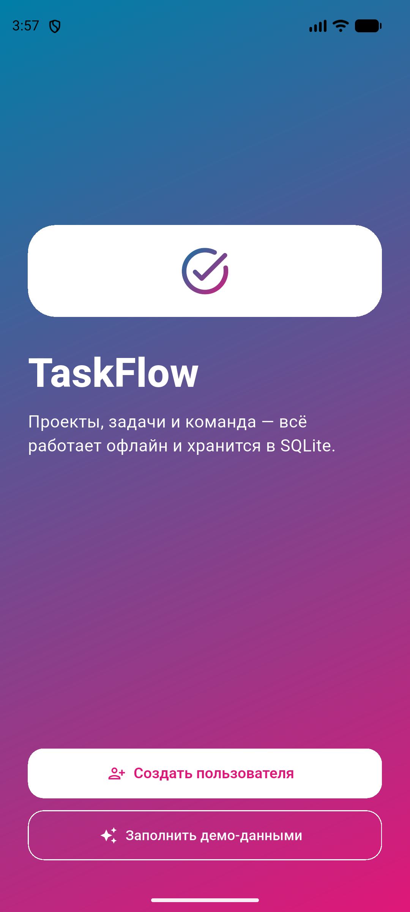
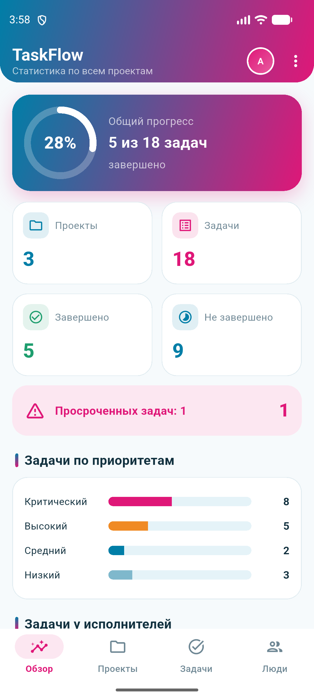
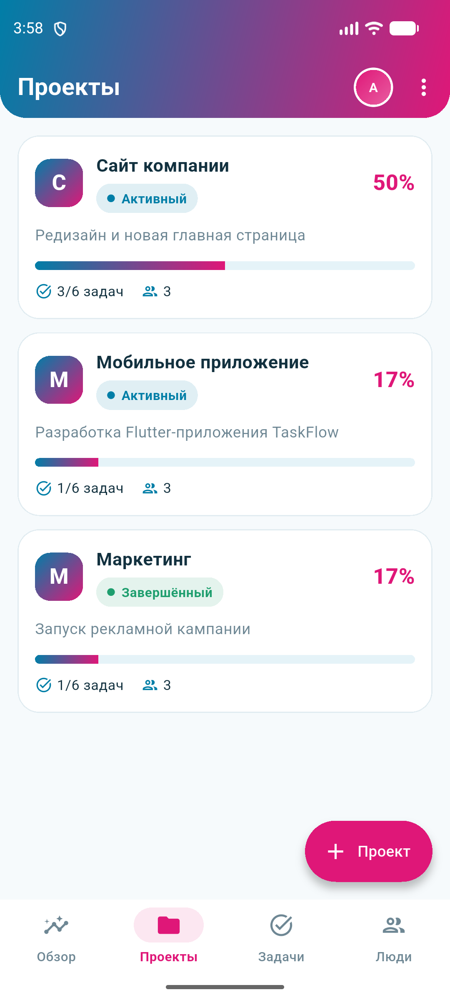
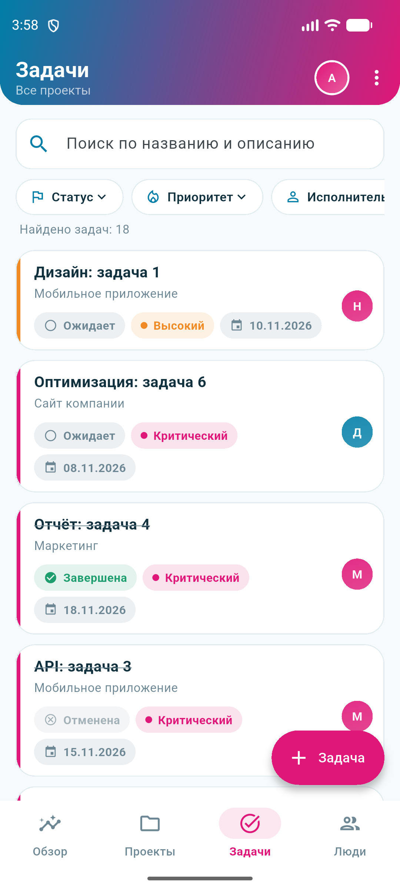
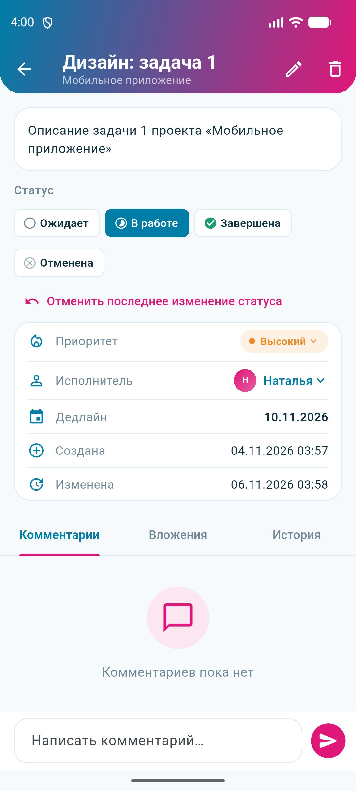
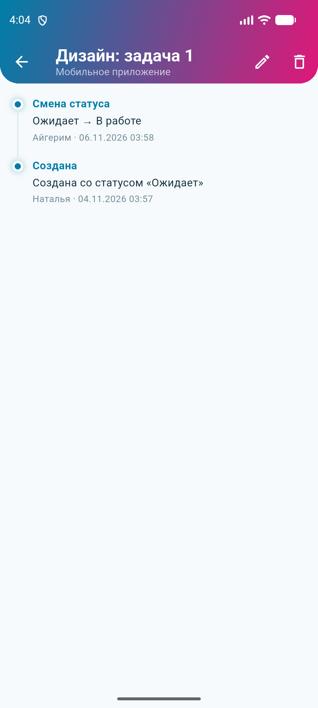

# TaskFlow (практическое задание № 10)

Мобильное приложение на Flutter для управления проектами и задачами. Все данные хранятся локально
в **SQLite через Drift**, приложение полностью работает офлайн.
Дизайн: синий `#007ea7`, розовый `#df1778` и белый.

## Запуск

```bash
flutter pub get
dart run build_runner build   # генерирует app_database.g.dart
flutter run
flutter test                  # 25 тестов на настоящей SQLite в памяти
```

При первом запуске можно создать пользователя или нажать «Заполнить демо-данными».
Большая тестовая база: меню ⋮ → «Производительность».

## Архитектура

```
lib/
├── database/      Database: таблицы Drift, индексы, миграции (app_database.dart, tables.dart)
├── models/        Model: enum-ы, модели экранов, ошибки бизнес-правил
├── repositories/  Repository: вся работа с БД (SQL только здесь)
├── state/         State management: AppState (текущий пользователь), TaskListController (фильтры, пагинация)
├── presentation/  Presentation: тема, экраны, виджеты
└── main.dart
```

Виджеты не выполняют SQL: они получают данные только из репозиториев (через Provider).

## База данных

| Таблица | Назначение | Связи |
|---|---|---|
| `users` | пользователи | `email` UNIQUE |
| `projects` | проекты | статус: active / completed / archived |
| `project_members` | участники проектов | Many-to-Many users ↔ projects, PK (project_id, user_id), роль Owner/Admin/Member |
| `tasks` | задачи | One-to-Many: проект → задачи (CASCADE), исполнитель → задачи (SET NULL) |
| `comments` | комментарии | задача → комментарии (CASCADE) |
| `attachments` | вложения (хранится **путь** к файлу) | задача → вложения (CASCADE) |
| `task_history` | история изменений | задача → история (CASCADE) |

- Внешние ключи включаются в `beforeOpen` (`PRAGMA foreign_keys = ON`).
- Индексы: `tasks(project_id, assignee_id, status, priority, deadline, created_at, title, deleted_at)`,
  `comments(task_id)`, `attachments(task_id)`, `task_history(task_id)`, `project_members(user_id)`, `users(name)`.
- Перед сохранением данные проверяются (`Validators`): обязательные поля, длина, формат email.

## Бизнес-правила

- Email уникален; нельзя удалить пользователя с незавершёнными задачами.
- Исполнитель — только участник проекта; нельзя дважды добавить пользователя в проект.
- Нельзя создать задачу без проекта и прокомментировать несуществующую задачу.
- Удалить комментарий может только его автор.
- **Лимит:** не больше 3 незавершённых задач у исполнителя с одним дедлайном (проверка запросом `COUNT`).

## Транзакции

- Создание задачи и первая запись истории выполняются в одной транзакции (`TaskRepository.createTask`).
  Если история не сохранилась, задача тоже не сохраняется (тест 12).
- Переназначение исполнителя: проверка участия, проверка лимита, изменение и запись в историю атомарно.
- Смена статуса и Undo тоже выполняются в транзакции вместе с записью истории.

## Миграция v1 → v2

`schemaVersion = 2`. В v1 у `tasks` не было поля `priority`. `onUpgrade` добавляет столбец
со значением по умолчанию `medium` и создаёт индекс. Тест `migration_test.dart` создаёт базу
«версии 1» с данными, открывает её приложением и проверяет, что записи сохранились, а `priority = medium`.

## Реактивность

Все экраны используют `watch()` Drift: списки, карточка задачи, история, комментарии и Dashboard
обновляются сами после любого изменения в базе.

## Dashboard

Все показатели считаются SQL-запросами (`StatsRepository`): число проектов и задач, завершённые,
незавершённые и просроченные задачи, задачи по приоритетам и исполнителям, процент выполнения проектов.

## Производительность

Экран «Производительность» генерирует **1 000 пользователей, 100 проектов и 10 000 задач**,
затем выполняет одни и те же запросы с индексами и без них (индексы временно удаляются)
и показывает среднее время. Списки задач и пользователей подгружаются страницами (`LIMIT`).

## Задания повышенной сложности

1. **Корзина (Soft Delete):** поле `deletedAt`; меню ⋮ → «Корзина»: восстановить или удалить навсегда.
2. **Undo:** кнопка «Отменить» в уведомлении после смены статуса и «Отменить последнее изменение статуса» в задаче.
3. **Лимит 3 задач на дедлайн:** `TaskRepository._ensureCapacity`.
4. **Целостность данных:** см. «Бизнес-правила».

## Тесты (25, все проходят)

| Требование | Тесты |
|---|---|
| Создание и удаление пользователей | 1, 3, 4 |
| Уникальность email | 2 |
| Создание проектов | 5, 7 |
| Добавление участников | 6 |
| Создание задач, целостность | 8, 9 |
| Проверка исполнителя | 10 |
| Изменение статуса и история | 11 |
| Транзакции | 12 |
| Undo, лимит задач | 13, 14 |
| Soft Delete и восстановление | 15, 16 |
| Комментарии, вложения | 17, 18 |
| Фильтрация, поиск, сортировка, пагинация | 19 |
| Реактивность watch() | 20 |
| Статистика | 21 |
| Миграции | 22 |

## Скриншоты

| Приветствие | Обзор | Проекты |
|---|---|---|
|  |  |  |

| Задачи | Задача | История |
|---|---|---|
|  |  |  |
