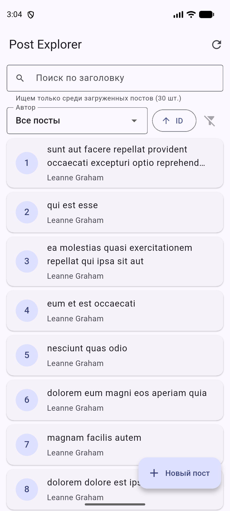
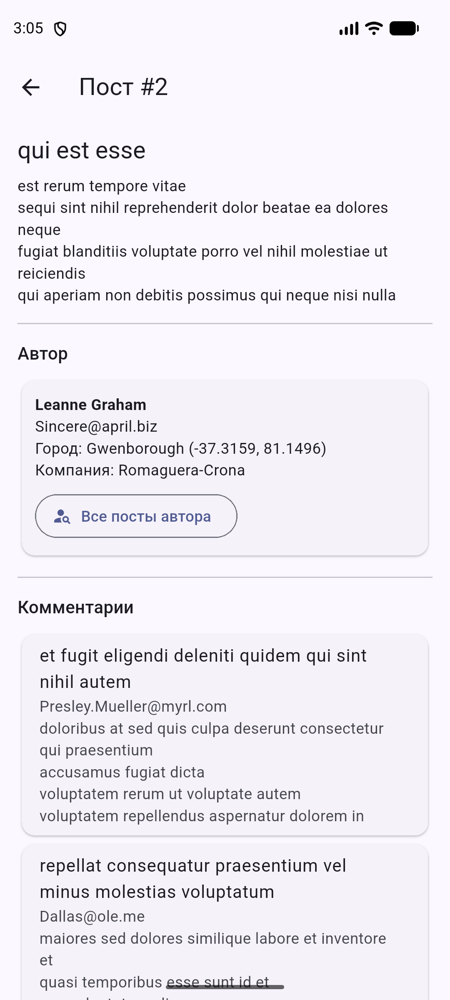
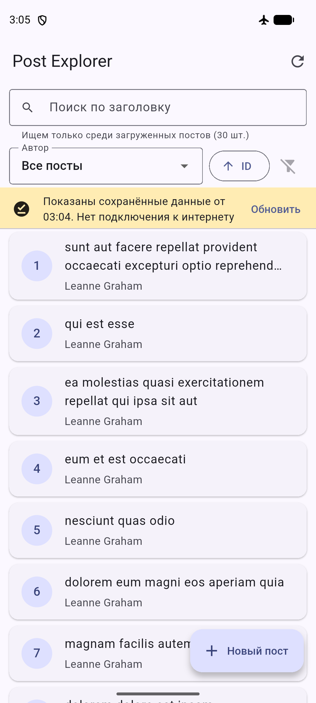

# Post Explorer (SRS 8)

Flutter-приложение для просмотра, поиска и создания постов из [JSONPlaceholder](https://jsonplaceholder.typicode.com).
Стек: **Dio + Retrofit + json_serializable + Provider + SharedPreferences**.

## Запуск

```bash
flutter pub get
dart run build_runner build        # генерирует *.g.dart (модели и Retrofit)
flutter run
```

Тесты (не требуют интернета, используют mock-адаптер Dio):

```bash
flutter test
```

## Архитектура

```
Presentation  (screens, widgets, state/ChangeNotifier)
      │  обращается только к репозиторию
Repository    (преобразование данных, кэш, ошибки -> AppException)
      │
Remote data source (Retrofit PostApi -> единый Dio + interceptors)   Local (PostCache / SharedPreferences)
      │
JSONPlaceholder REST API
```

```
lib/
├── core/
│   ├── network/dio_client.dart        единый Dio: baseUrl, таймауты, интерцепторы
│   ├── network/api_interceptor.dart   технические заголовки, ошибки, retry для GET
│   └── error/app_exception.dart       типы ошибок + понятные сообщения
├── data/
│   ├── models/ post.dart comment.dart user.dart   @JsonSerializable (+ *.g.dart)
│   ├── remote/post_api.dart           Retrofit: 5 обязательных + 2 доп. запроса
│   ├── local/post_cache.dart          кэш постов и авторов
│   └── repositories/post_repository.dart
├── presentation/
│   ├── screens/  список, детали, создание поста
│   ├── widgets/  карточка поста, состояния Loading/Error/Empty
│   └── state/    PostListNotifier, PostDetailNotifier, CreatePostNotifier, фильтры
└── main.dart
```

**Зачем каждый слой**

| Слой | Задача |
|---|---|
| **Dio** | HTTP-клиент: таймауты, интерцепторы, логирование, единая обработка ошибок |
| **Retrofit** | Описывает API аннотациями (`@GET`, `@POST`, `@Query`, `@Path`) и генерирует код запросов — не нужно вручную собирать URL |
| **json_serializable** | Генерирует `fromJson`/`toJson` — без ручного парсинга и опечаток в ключах |
| **Repository** | Прячет от UI источник данных (сеть/кэш), превращает ошибки в `AppException` |
| **State (ChangeNotifier)** | Хранит состояние экрана; UI только отображает его |

## API-запросы (`lib/data/remote/post_api.dart`)

| № | Запрос | Где используется |
|---|---|---|
| 1 | `GET /posts?_page=&_limit=10` | список с пагинацией |
| 2 | `GET /posts/{id}` | экран деталей |
| 3 | `GET /posts?userId={id}` | фильтр по автору |
| 4 | `GET /posts/{id}/comments` | комментарии |
| 5 | `POST /posts` | создание поста |
| + | `GET /users`, `GET /users/{id}` | список авторов, карточка автора |

Сортировка по ID — параметры `_sort=id&_order=asc|desc`.

## Состояния интерфейса

- **Loading** — первичная загрузка (`ListStatus.loading`) и подгрузка страницы (`PageStatus.loading`) — разные поля, а не один `isLoading`.
- **Success** — данные с сервера.
- **Error** — экран ошибки с кнопкой «Повторить»; ошибка следующей страницы показывается внизу списка, загруженные посты остаются.
- **Cached** — жёлтый баннер «Показаны сохранённые данные от ЧЧ:ММ».
- **Empty** — «Постов нет» / «По запросу … ничего не найдено» + «Сбросить фильтры».

## Ошибки (`AppException`)

`NoConnectionException`, `TimeoutAppException`, `ClientException` (4xx), `ServerException` (5xx),
`ParsingException` (некорректный JSON), `UnknownException`. Пользователь видит понятный текст,
технические детали пишутся в лог (`[API ERROR] ...`).

## Кэширование: поведение приложения

- **Первый запуск** — кэша нет: индикатор загрузки → посты с сервера → сохраняются в кэш.
- **Повторное открытие** — сразу показываются сохранённые посты с баннером «Обновляем…», параллельно идёт запрос; после ответа список и кэш обновляются.
- **Нет интернета** — GET-запрос повторяется 2 раза (RetryInterceptor), затем показываются сохранённые данные с баннером «Нет подключения к интернету». Последний успешный результат не удаляется. Если кэша нет — экран ошибки с кнопкой «Повторить».
- **Pull-to-refresh** — потянуть список вниз или кнопка ⟳.

Для каждого фильтра (все посты / конкретный автор, порядок сортировки) свой ключ кэша.

## Пагинация и фильтры

- первые 10 постов, следующая страница при прокрутке (и кнопка «Загрузить ещё»);
- защита от повторной загрузки одной страницы (`_loadingPage`) и от дубликатов по `id`;
- при смене автора/сортировки страницы сбрасываются; ответы на старые запросы игнорируются (счётчик `_generation`), поэтому результаты не смешиваются;
- **поиск по заголовку локальный — только среди загруженных постов**, это написано под полем поиска.

## Создание поста

Валидация: title 5–100 символов, body 10–1000, автор из списка. Кнопка блокируется во время запроса.
После ответа показывается JSON от сервера, а пост добавляется в список с меткой **«создан локально»**:
JSONPlaceholder только имитирует создание (всегда возвращает `id: 101`) и не хранит пост.

## Дополнительное задание

**Retry policy** — `RetryInterceptor` повторяет только GET-запросы при временных сетевых ошибках
(обрыв соединения, таймаут) с увеличивающейся задержкой. POST автоматически не повторяется,
чтобы не создать пост дважды.

## Тесты (`flutter test` — 16 тестов, все проходят)

| Требование | Тест |
|---|---|
| JSON → Post | `models_test.dart` «1. JSON -> Post» |
| Post → JSON | `models_test.dart` «2. Post -> JSON» |
| Загрузка через репозиторий | `post_repository_test.dart` «3. успешная загрузка…» |
| Ошибка сервера | `post_repository_test.dart` «4. ошибка сервера 500…» |
| Фильтрация по автору/заголовку | `post_list_test.dart` группа «5. фильтрация» |
| Защита от дублирующейся загрузки | `post_list_test.dart` «6. защита от повторной загрузки…» |
| Доп.: POST через mock-адаптер Dio | `post_repository_test.dart` «POST через mock-адаптер…» |
| Доп.: некорректный JSON, 404, смешивание фильтров, ошибка страницы | остальные тесты |

## Скриншоты

| Список | Детали | Офлайн (кэш) |
|---|---|---|
|  |  |  |
